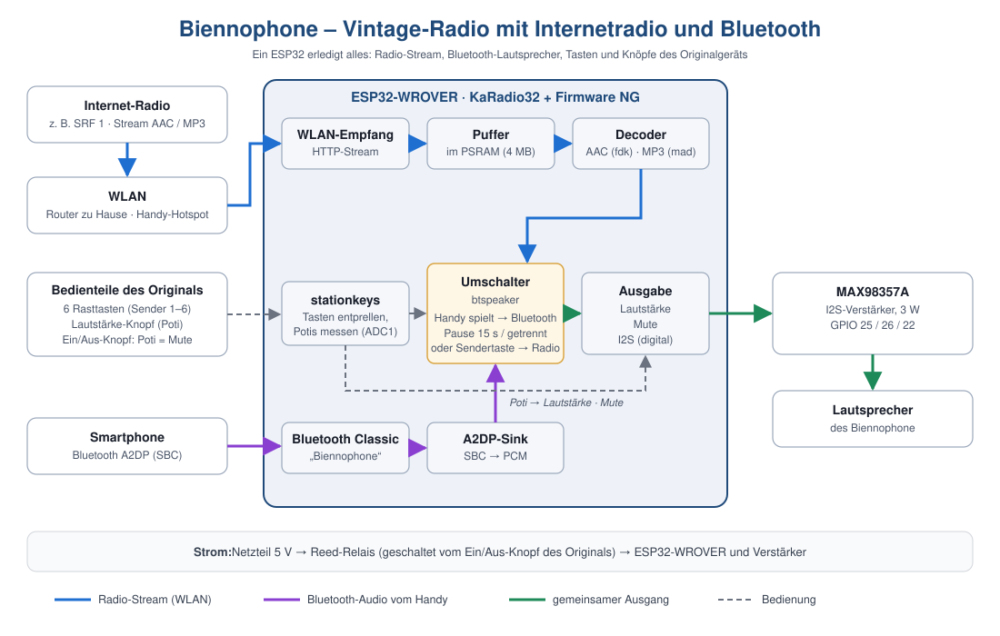

# Biennophone – ein Vintage-Radio mit Internetradio und Bluetooth

Ein altes **Biennophone** spielt wieder: Internetradio über WLAN, Bluetooth-Lautsprecher fürs Handy, bedient mit den originalen Rasttasten und Drehknöpfen. Die ganze Elektronik ist ein einziger **ESP32-WROVER** mit der freien Firmware [KaRadio32](https://github.com/karawin/Ka-Radio32) und unserer Ergänzung „Firmware NG“.



## Auf einen Blick

- **6 Sendertasten** – die originalen Rasttasten wählen je einen Internetradio-Sender.
- **Bluetooth immer bereit** – das Radio erscheint auf dem Handy als **„Biennophone“**. Spielt das Handy hörbar Musik oder ein Video, schaltet das Radio nach ca. 1,5 s um; Benachrichtigungen und Stille schalten nicht um. Pause am Handy → das Radio bleibt still. Handy getrennt oder eine Sendertaste → zurück zum Radio. (Seit 09.11.2026; bis Tag `firmware-ng-bt-v2` setzte das Radio nach Bluetooth-Betrieb immer wieder ca. 30 s aus, siehe [VERSIONEN.md](VERSIONEN.md).) Kein Neustart, keine Extra-Taste.
- **Originale Knöpfe** – der Lautstärke-Knopf regelt die Lautstärke, der Ein/Aus-Knopf schaltet über ein Reed-Relais den Strom und schaltet mit seinem Poti stumm (Mute).
- **Robust** – Neustart nach Abstürzen, Start-Wächter (Hardware-Watchdog), mehrere WLAN-Versuche beim Kaltstart.
- **Webinterface** von KaRadio für Senderliste und WLAN bleibt nutzbar.

## Stabile Version

> **Stand 09.11.2026: [`firmware-ng-bt-v3`](https://github.com/dansoft-ch/KaRadio/tree/firmware-ng-bt-v3)** – läuft stabil mit WLAN und Bluetooth, am Gerät getestet.
> Die fertigen Dateien zum Flashen liegen im Tag unter [`firmware/bin/`](https://github.com/dansoft-ch/KaRadio/tree/firmware-ng-bt-v3/firmware/bin).

Weiterentwickelt wird in `main`. Eine Übersicht aller Versionen steht in [`VERSIONEN.md`](https://github.com/dansoft-ch/KaRadio/blob/main/VERSIONEN.md), das Factsheet zum Ausdrucken (2 Seiten, inkl. Flash-Anleitung) in [`KaRadio-Factsheet-FirmwareNG-BT.docx`](https://github.com/dansoft-ch/KaRadio/blob/main/KaRadio-Factsheet-FirmwareNG-BT.docx).

## So funktioniert es

**Radio:** Der ESP32 holt den Stream (AAC oder MP3) per WLAN, puffert ihn im 4-MB-PSRAM, dekodiert ihn und gibt das digitale Audiosignal über **I2S** an den Verstärker **MAX98357A**, der direkt den Lautsprecher treibt.

**Bluetooth:** Gleichzeitig läuft klassisches Bluetooth als **A2DP-Sink**. Das Handy schickt SBC-Audio, der ESP32 wandelt es in PCM und gibt es über denselben Ausgang aus. Der Umschalter (`btspeaker.c`) stoppt dafür den Radio-Stream, übernimmt den I2S-Ausgang und gibt ihn später wieder ans Radio zurück.

**Bedienung:** `stationkeys.c` liest die Tasten (entprellt, Rasttasten-tauglich) und die Potis über den ADC1. Lautstärke und Mute wirken auf beide Quellen gleich.

Warum nur ein ESP32-WROVER? Er kann **klassisches Bluetooth** (der ESP32-S3 kann nur Bluetooth Low Energy, damit geht keine Musik) und hat **PSRAM** für Stream-Puffer und Netzwerk.

## Hardware

| Teil | Anschluss |
|---|---|
| ESP32-WROVER (ESP32-D0WD-V3, 16 MB Flash, PSRAM) | USB-Seriell-Chip CH343 |
| Verstärker MAX98357A | LRC → GPIO 25, BCLK → GPIO 26, DIN → GPIO 22, VIN → 5 V, GND |
| Tasten 1–6 (Rasttasten gegen GND, interner Pull-up) | GPIO 13, 14, 27, 15, 5, 2 |
| Lautstärke-Poti (Enden an 3,3 V / GND) | Schleifer → GPIO 39 |
| Ein/Aus-Knopf: Poti (Mute, Drehrichtung ±10 %) | Schleifer → GPIO 36 |
| Ein/Aus-Knopf: Schalter | Reed-Relais in der 5-V-Zuleitung (ohne Firmware) |
| IR-Empfänger (optional) | GPIO 21 |

Potis nur an 3,3 V, nie an 5 V, und nur an ADC1-Pins (32–39). GPIO 2, 5 und 15 sind Boot-Pins – eingerastete Tasten beim Einschalten sind unkritisch, zum Flashen Taste 1 einrasten. Die Pins stehen in [`firmware/standard_psram_dan_keys.csv`](https://github.com/dansoft-ch/KaRadio/blob/main/firmware/standard_psram_dan_keys.csv) und lassen sich ohne neue Firmware ändern (Eintrag `255` = nicht benutzt).

## Flashen

Die Dateien aus `firmware/bin/` des Tags `firmware-ng-bt-v3` (oder von `main` nach `git pull`). `otadata_blank.bin` (8 KB, nur `FF`) ist immer gleich und passt zu jeder Version.

| Adresse | Datei | Inhalt |
|---|---|---|
| `0x1000` | `bootloader.bin` | Bootloader mit Start-Wächter |
| `0x8000` | `partitions.bin` | Partitionstabelle (App 3,5 MB, ohne OTA) |
| `0xd000` | `otadata_blank.bin` | leert „otadata“, damit sicher die neue Firmware startet |
| `0x10000` | `KaRadio32.bin` | Firmware |
| `0x3a2000` | `standard_psram_dan_keys.bin` | Hardware-Konfiguration (Pins) |

**Variante A – Skript (PowerShell, nutzt esptool aus der Arduino IDE):**
```
git switch --detach firmware-ng-bt-v3
powershell -ExecutionPolicy Bypass -File .\firmware\flash.ps1 -Port COM3
```
Das Skript prüft die Seriennummer des WROVER (bricht ab, wenn der ESP32-S3 dranhängt), löscht otadata und schreibt alle Dateien.

**Variante B – Espressif Flash Download Tool:** ChipType ESP32, SPI 40 MHz, DIO, „DoNotChgBin“ an, Dateien und Adressen wie oben. Wichtig:
- **Nicht** mehr `KaRadio32.bin` an `0x1D0000` flashen (beim Original-KaRadio die zweite App-Partition, hier mitten in der Firmware).
- **ERASE** löscht den ganzen Flash inkl. WLAN-Daten und Senderliste – nur für eine Neuinstallation. Danach das Radio neu einrichten: WLAN „WifiKaRadio“, http://192.168.4.1.

Nach dem Flashen meldet der serielle Monitor (115200 Baud) u. a. `btspeaker: sichtbar als "Biennophone"` und `READY`.

## Entwicklungsgeschichte

Die Sketche der frühen Lösungen liegen heute in [`archiv/`](archiv/README.md).

| Datum | Schritt | Was wir gelernt haben |
|---|---|---|
| 24.10.2026 | **Arduino Pro Mini sendet IR-Codes** (`TastaturCode.ino`, später mit Lautstärke `TastaturLautstaerkeIR.ino`) – die Tasten imitieren die IR-Fernbedienung von KaRadio. | Lautstärke per IR nur in Schritten, lief nur auf einem von drei Boards zuverlässig. |
| 25.10.2026 | **Pro Mini sendet Textbefehle per UART** (`TastaturLautstaerkeUART.ino`): `cli.play("n")`, `cli.vol("0..254")`. | Direkte Befehle statt IR sind genauer und zuverlässiger. |
| 05.11.2026 | **ESP32-S3 als USB-Host** (`TastaturLautstaerkeUART-S3/`): schickt die Befehle übers USB-Kabel an den WROVER, startet ihn per RTS neu, wenn er beim Kaltstart hängt, RGB-LED zeigt Sender und Lautstärke. | Funktioniert, aber zwei Boards, eigener USB-Treiber und Start-Überwachung sind aufwendig. |
| 06.11.2026 | **Firmware NG** (Branch `firmware-ng`, Tag `firmware-ng-v1`): KaRadio32 liest Tasten und Poti selbst; der S3 entfällt. Gebaut wird per GitHub Actions (ESP-IDF 3.3.6), weil lokal keine ESP-IDF-Umgebung nötig sein soll. | Eigene Funktionen gehören in eigene Dateien plus kleinen Patch – dann bleibt KaRadio wartbar. |
| 07.11.2026 | **Bluetooth v1** (Tag `firmware-ng-bt-v1`): Taste 6 = Bluetooth, Wechsel per Neustart. Dazu Mute über den Ein/Aus-Knopf, Start-Wächter, WLAN-Wiederholversuche. | Bluetooth reserviert ca. 56 KB internen Speicher – ohne Gegenmassnahmen brach der Radio-Stream ab. KaRadio richtet I2S nur für den Radio-Decoder ein. |
| 07.11.2026 | **Bluetooth v2** (Tag `firmware-ng-bt-v2`): Bluetooth immer an, automatische Umschaltung, Taste 6 wieder Sender 6. | Mit WLAN-/Netzwerkpuffern und AAC-Puffern im PSRAM passen Radio und Bluetooth gleichzeitig in den Speicher (gemessen: 27 KB intern frei beim Radio, 32 KB bei Bluetooth). |
| 09.11.2026 | **Bluetooth v3** (Tag `firmware-ng-bt-v3`, **aktuell**): Umschalten aufs Handy nur bei hörbarem Ton. | Ein verbundenes Handy meldet auch bei Benachrichtigungen und Stille „spielt“ – in v2 setzte das Radio dadurch immer wieder ca. 30 s aus. |

## Wichtige technische Entscheidungen

- **Speicher:** Der ESP32 hat nur ca. 520 KB internen Speicher, Bluetooth belegt davon rund 90 KB. Deshalb liegen WLAN-/Netzwerkpuffer, kleine Speicherblöcke ab 4 KB und die Puffer des AAC-Decoders im PSRAM; die festen WLAN-Puffer sind reduziert (Empfang 10, Senden 6).
- **Partitionen:** Mit Bluetooth ist die Firmware ca. 2,1 MB gross. Die App-Partition ist auf 3,5 MB vergrössert, die zweite OTA-Partition entfällt (kein Web-Update). Senderliste, WLAN-Daten und Hardware-Konfiguration liegen an denselben Adressen wie beim Original.
- **Kaltstart:** Der erste WLAN-Versuch scheitert oft. Die Firmware versucht dasselbe Netz bis zu 3-mal, startet dann einmal neu und geht erst danach in den AP-Modus. Ein Hardware-Watchdog startet neu, wenn KaRadio nicht innerhalb von 90 s „READY“ meldet.
- **Startet der WROVER beim Einschalten gar nicht** (kein Text im Monitor), ist das Hardware: meist zu kurze Reset-Verzögerung – Kondensator 1–10 µF von EN nach GND.

## Bauen

Auf dem PC ist keine ESP-IDF nötig. GitHub Actions ([`.github/workflows/firmware.yml`](https://github.com/dansoft-ch/KaRadio/blob/main/.github/workflows/firmware.yml)) baut bei jedem Push in `firmware/`:

1. Ka-Radio32 auf festem Commit (Release 2.4 R1) holen,
2. [`firmware/karadio.patch`](https://github.com/dansoft-ch/KaRadio/blob/main/firmware/karadio.patch) anwenden und `stationkeys.c` / `btspeaker.c` dazukopieren,
3. mit ESP-IDF 3.3.6 bauen (Ubuntu-20.04-Container),
4. die fertigen `.bin`-Dateien automatisch nach `firmware/bin/` committen. Bei einem Tag `firmware-ng-v*` entsteht zusätzlich ein GitHub-Release.

Schlägt der Build fehl, stehen die Fehlerzeilen als Hinweise beim Build (auch ohne Anmeldung lesbar). Wie der Patch neu erzeugt wird, steht in [`CLAUDE.md`](https://github.com/dansoft-ch/KaRadio/blob/main/CLAUDE.md).

## Repository

| Ort | Inhalt |
|---|---|
| Branch `main` | aktueller Stand und Weiterentwicklung |
| Tag `firmware-ng-bt-v3` | **stabile Version**, läuft auf dem Radio |
| Tags `firmware-ng-bt-v1`, `-v2` | frühere Bluetooth-Versionen |
| Tag `firmware-ng-v1` (+ Release) | Firmware NG ohne Bluetooth |
| `firmware/` | eigener Code (`stationkeys.c`, `btspeaker.c`), Patch, Konfiguration, Flash-Skript, fertige `.bin` |
| `archiv/` | frühere Lösungen mit Arduino Pro Mini (IR, UART) und ESP32-S3; Tags `archiv/promini-ir-uart`, `archiv/s3-usbhost` |
| `VERSIONEN.md` | was welche Version kann und wie man zurückkommt |
| `CLAUDE.md` | technische Projektnotizen (Ports, Seriennummern, Stolpersteine) |

Grundlage: [KaRadio32](https://github.com/karawin/Ka-Radio32) von KaraWin.
